<div align="center">

# 🛒 Amazon Cypress BDD Automation — JavaScript · Cypress · Cucumber

### 39 Gherkin scenarios covering sign-in, search, cart, checkout and account management. They run against a stateful Amazon mock, so every assertion checks real values. Green on Chrome, Firefox and Edge in GitHub Actions.

[](https://git.io/typing-svg)

<!-- ============ STATUS BAR ============ -->
[](https://github.com/rbchy/Amazon-Cypress-JavaScript-Automation/actions/workflows/ci.yml)


</div>

---

## 📌 At a Glance

<table>
<tr>
<td width="50%" valign="top">

**🙋 What this is**

A **BDD test framework** for Amazon-style e-commerce flows, built with **Cypress 14** and **Cucumber** (`@badeball/cypress-cucumber-preprocessor`). It covers 13 test cases (TC-001 to TC-013) in **39 scenarios**:

- sign-in, registration, logout, 2FA
- search with **filters and sorting**, cart, **checkout with coupons**
- returns, Prime, browsing and order history, Visa card, Associates

**Why a mock?** Live amazon.com blocks automated browsers with bot checks and CAPTCHAs, and its markup changes constantly. So every Amazon page is served by `cy.intercept`. The shopping and history pages are a **stateful mock**: filters really filter, the cart really holds quantities, coupons really change the total. The step definitions can therefore **fail** when the behaviour is wrong (see *Proof the tests can fail*).

</td>
<td width="50%" valign="top">

**📍 Quick facts**

| | |
|---|---|
| 🧪 **Scenarios** | 39 in 3 feature files |
| 🧩 **Step definitions** | 219 |
| 🌐 **Browsers in CI** | Chrome · Firefox · Edge (headless) |
| ⏱️ **Run time** | ≈ 1 min 10 s per browser |
| 🔁 **Retries in CI** | 0 (failures are not hidden) |
| 📊 **Reports** | Cucumber HTML dashboard · Mochawesome · screenshots |
| 🧹 **Lint** | ESLint + `eslint-plugin-cypress` |
| 🔐 **Secrets** | none; `.env.example` only |

</td>
</tr>
</table>

---

## ✅ Latest Results (GitHub Actions)

| Feature file | Scenarios | Chrome | Firefox | Edge |
|---|---:|:---:|:---:|:---:|
| `01-authentication.feature` | 10 | ✅ 10 · 15 s | ✅ 10 · 15 s | ✅ 10 · 15 s |
| `02-shopping.feature` | 13 | ✅ 13 · 26 s | ✅ 13 · 29 s | ✅ 13 · 28 s |
| `03-account-management.feature` | 16 | ✅ 16 · 24 s | ✅ 16 · 26 s | ✅ 16 · 26 s |
| **Total** | **39** | **39 / 39** | **39 / 39** | **39 / 39** |

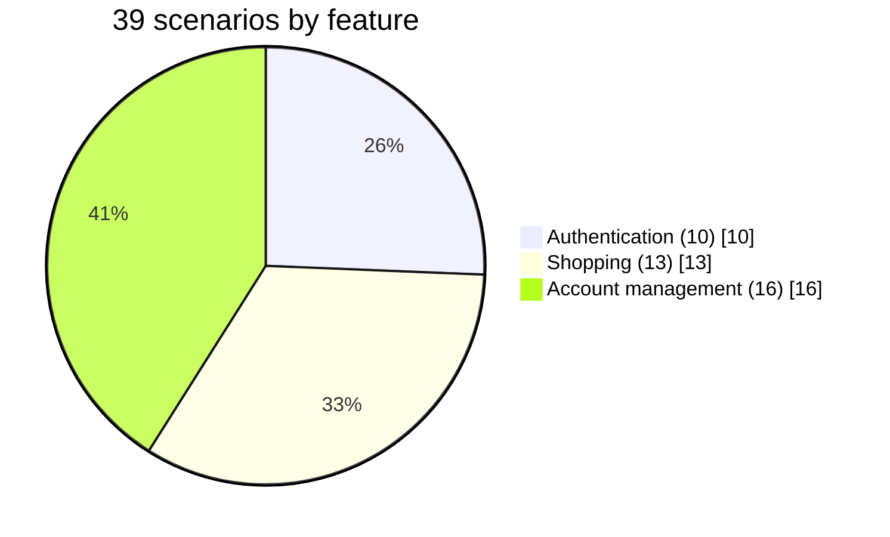

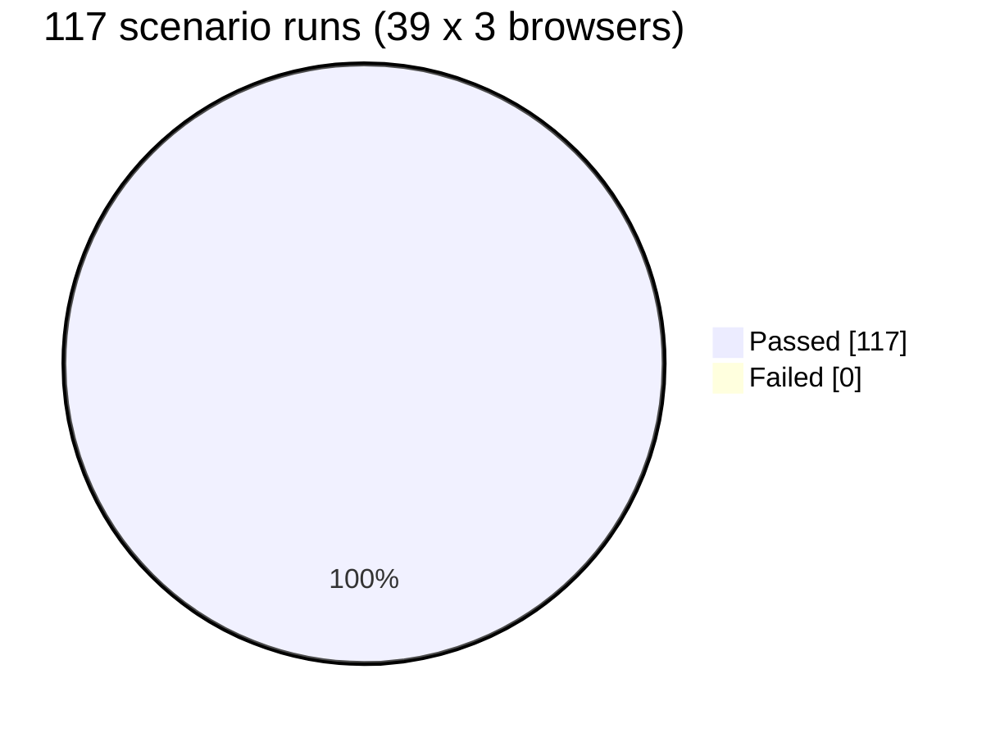

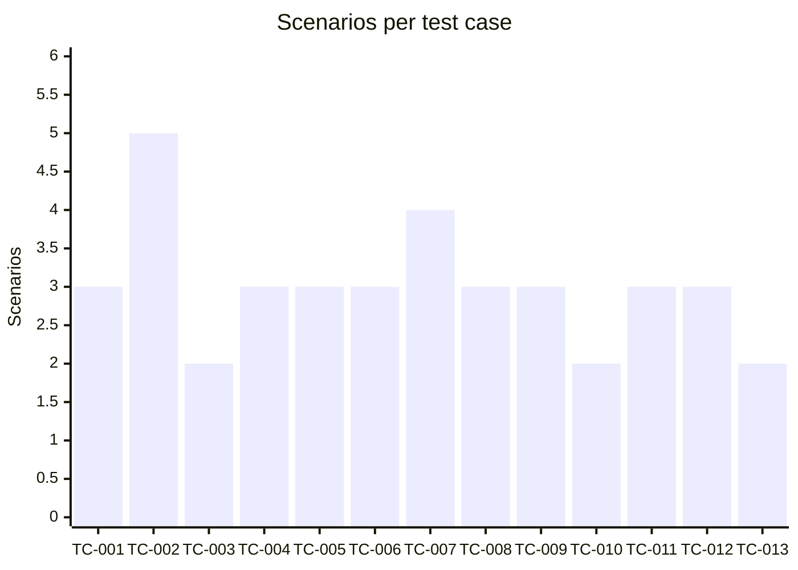

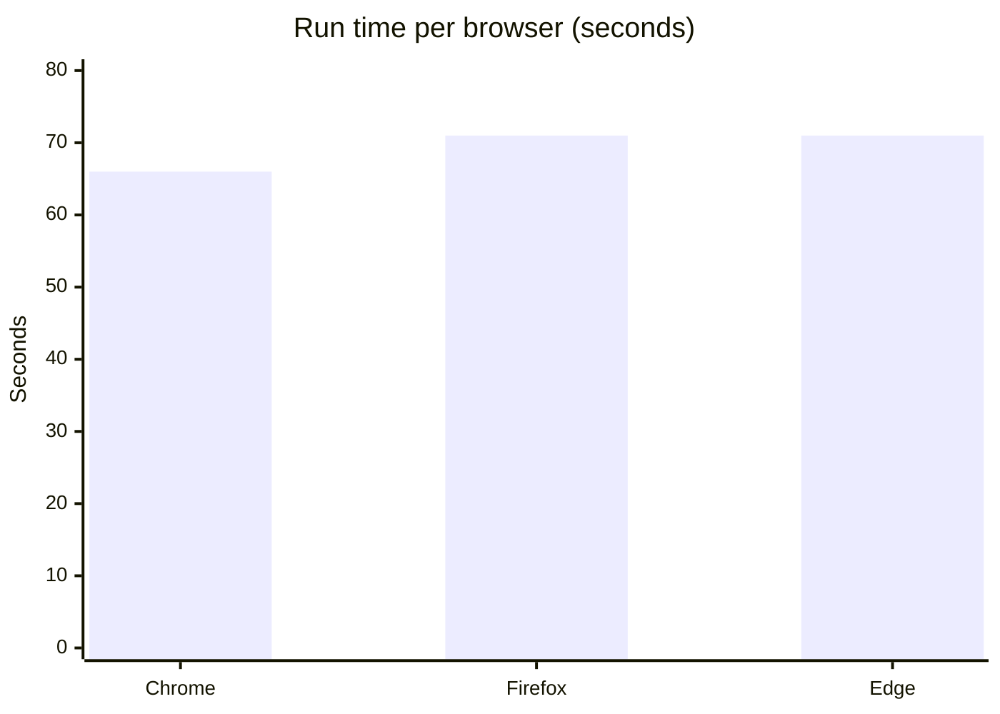

---

## 🧪 Proof the tests can fail

Before this rework many steps passed **whatever the page showed**:

- filters and sorting were empty steps
- the quantity step always picked option 0
- cart-count steps only checked that the badge existed
- "Added to Cart" was printed on every product page
- the data-table steps ignored their tables

To prove the new assertions catch bugs, three bugs were planted in the mock on a throw-away branch:

| Planted bug | Scenario that went red | Failing step |
|---|---|---|
| price sort removed | TC-004 Sort search results | `results should be sorted by ascending price` |
| cart ignores quantity | TC-005 Add multiple items to cart | `Cart count should display "3"` |
| cart ignores quantity | TC-006 Clear entire cart | `Given I have multiple items in cart` |
| SAVE10 gives no discount | TC-007 Apply coupon code | `Order total should be reduced` |

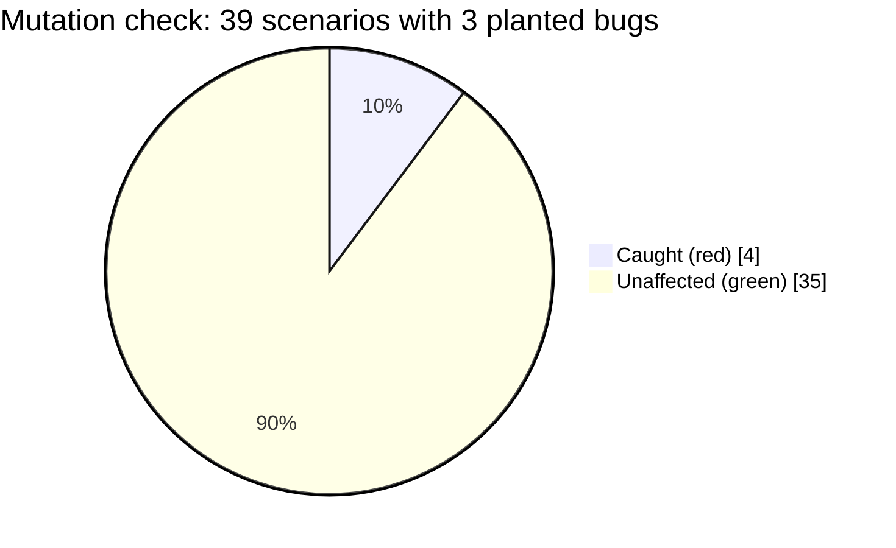

---

## 🏗️ Architecture

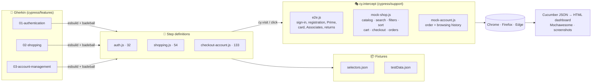

### CI pipeline

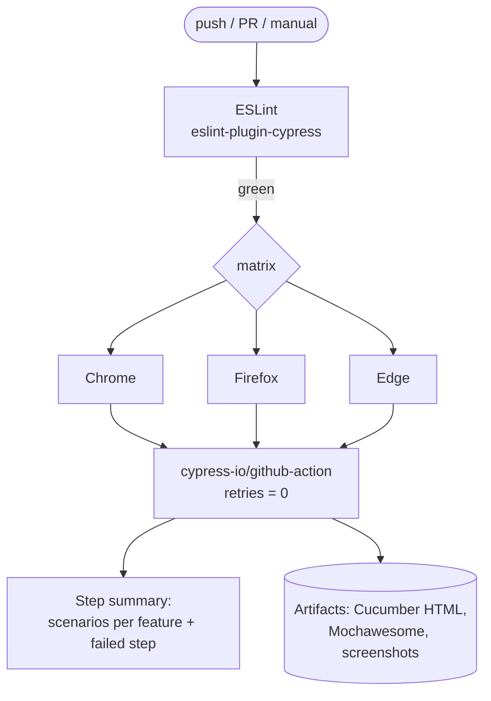

### Cart and checkout flow (stateful mock)

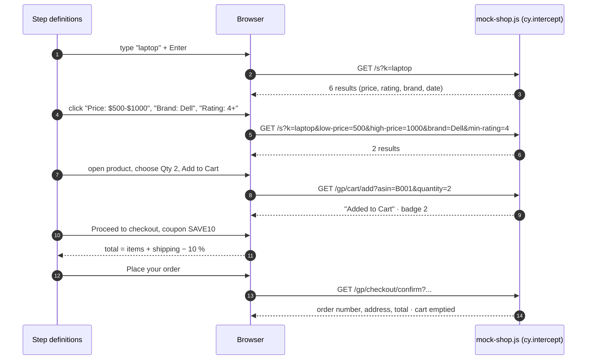

### Cart state

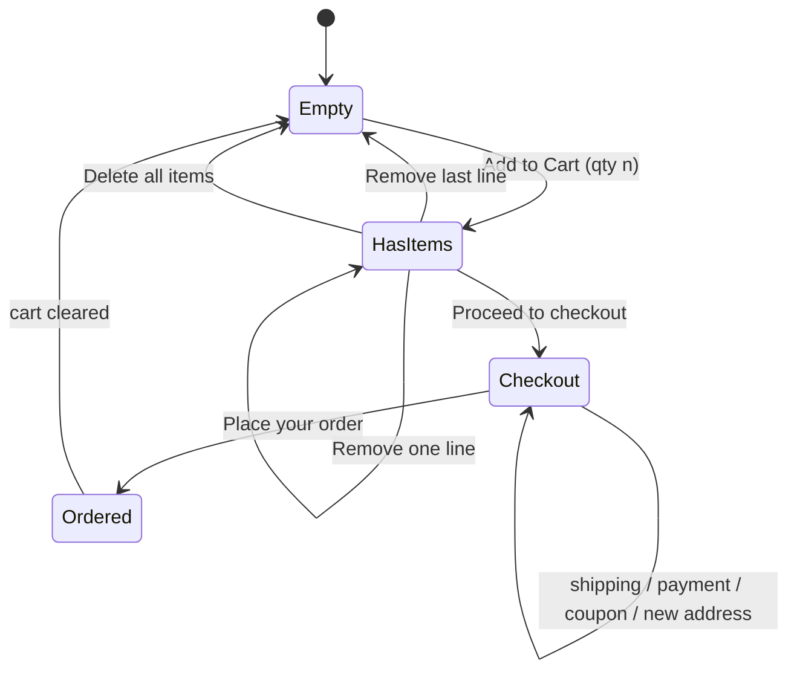

### Mock data model

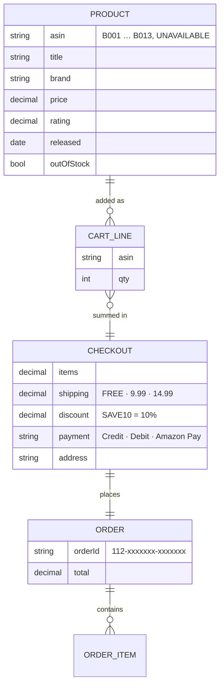

---

## 🎯 Test Coverage

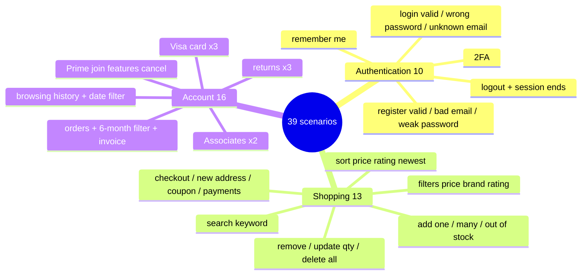

| TC | Module | Scenarios | What the steps check |
|---|---|---:|---|
| TC-001 | Registration | 3 | account created; exact error text for bad email / short password |
| TC-002 | Login | 5 | greeting switches from *Sign in* to *Test User*; exact error text; remember-me; OTP |
| TC-003 | Logout | 2 | session ends, protected page redirects to sign-in |
| TC-004 | Search | 3 | every title matches the keyword; every price in range, brand = Dell, rating ≥ 4; sort order of prices, ratings, release dates |
| TC-005 | Add to cart | 3 | badge goes 0 → 1; 2 lines with quantities summing to 3; out-of-stock button disabled |
| TC-006 | Cart | 3 | removed title gone, badge decreases, subtotal = Σ price × qty; quantity 3 recalculates line + subtotal; delete all → `$0.00` |
| TC-007 | Checkout | 4 | items `$834.98`; order number format; new address on the confirmation; SAVE10 → `-$83.50`, total `$751.48`; Amazon Pay hides the card fields |
| TC-008 | Returns | 3 | return label, status, tracking number, refund date |
| TC-009 | Prime | 3 | benefits listed in the feature table, sign-up and cancel flows |
| TC-010 | Browsing history | 2 | newest first; "Last 30 / 90 days" hide older items; clear empties the list |
| TC-011 | Orders | 3 | every order shows the 5 fields from the table; 6-month filter; invoice contains the 5 sections |
| TC-012 | Visa card | 3 | every row of the feature table is on the page |
| TC-013 | Associates | 2 | application flow; affiliate URL, QR code, HTML code, copy option |

> Mock depth: search, cart, checkout, orders and browsing history are **stateful**. Sign-in and registration have server-side rules (wrong password, unknown email, invalid email, short password). Prime, Visa card, Associates and returns are **static pages**, so those scenarios check page content and navigation only.

---

## ▶️ Running Locally

**Prerequisites:** Node 18+ (CI uses 20), Chrome / Firefox / Edge.

```bash
npm ci                          # installs Cypress 14 + Cucumber preprocessor
cp .env.example .env            # optional; nothing secret is needed
npm test                        # all 39 scenarios, Electron headless
npm run test:chrome             # or :firefox / :edge
npm run test:shopping           # one feature file (also :single, :account)
npm run open                    # Cypress app
node scripts/generate-report.js # Cucumber HTML dashboard
npm run lint                    # ESLint
```

| Report | Path |
|---|---|
| Cucumber HTML dashboard | `cypress/results/cucumber-html-report/index.html` |
| Cucumber built-in HTML | `cypress/results/cucumber-report.html` |
| Cucumber JSON | `cypress/results/cucumber-json/cucumber-report.json` |
| Mochawesome | `cypress/results/report.html` |
| Failure screenshots | `cypress/screenshots/` |

---

## 📁 Project Structure

```text
Amazon-Cypress-JavaScript-Automation/
├── .github/workflows/ci.yml        # lint → Chrome / Firefox / Edge
├── cypress.config.js               # esbuild + Cucumber + Mochawesome
├── cypress/
│   ├── features/                   # 01-authentication · 02-shopping · 03-account-management
│   ├── fixtures/                   # selectors.json · testData.json
│   └── support/
│       ├── e2e.js                  # global hooks, sign-in / account stubs, custom commands
│       ├── mock-shop.js            # stateful catalog, search, cart, checkout, orders
│       ├── mock-account.js         # stateful order history + browsing history
│       └── step_definitions/       # auth.js · shopping.js · checkout-account.js
├── scripts/generate-report.js      # multiple-cucumber-html-reporter
├── docs/                           # test-case workbook + first-version notes
└── .env.example
```

---

## 🧹 Maintenance Log

| Area | Before | Now |
|---|---|---|
| Repo | **README only**, no code on GitHub | full framework source; reports, PDFs, `node_modules`, `.env` ignored |
| Install | `package-lock.json` out of sync → `npm ci` failed | lock regenerated |
| Filters / sort | empty steps | real refinements and sort; values checked |
| Quantity | always `select(0)` | selects the requested quantity |
| Cart counts | "badge exists" | exact counts, line totals, subtotal maths |
| "Added to Cart" | printed on every product page | only after an add |
| Data tables | `I should see:` checked `body` exists; tables ignored | every table row asserted |
| Error messages | any error box passed | exact text from the feature |
| Waits | 24 fixed `cy.wait(ms)` | removed; Cypress retry-ability + assertions |
| Dead code | unused `amazon-mock.js` (36 KB), duplicate config and fixtures | removed |
| Config | `allowCypressEnv` (a Cypress 15 option) | removed for Cypress 14 |
| Lint | `npm run lint` had no config | `.eslintrc.json` with `eslint-plugin-cypress` |
| CI | none | GitHub Actions, 3 browsers, 0 retries, failed step in the run summary |

---

## 📈 Roadmap

- [x] CI on Chrome, Firefox and Edge
- [x] Stateful mock for shopping, orders and history
- [ ] Make Prime, Visa card, Associates and returns stateful too
- [ ] Page objects on top of `selectors.json`
- [ ] `cypress-axe` accessibility checks
- [ ] Publish the Cucumber dashboard to GitHub Pages

---

## 🔗 Related Projects

| Repo | What it is |
|---|---|
| [AmazonSeleniumTest](https://github.com/rbchy/AmazonSeleniumTest) | Selenium + Cucumber against live Amazon, with bot-wall detection |
| [QaBrainsAutomationCypressJavaScript](https://github.com/rbchy/QaBrainsAutomationCypressJavaScript) | Cypress suite for practice.qabrains.com |
| [NorthFace_AutomationExercise-BDD-Test-Automation](https://github.com/rbchy/NorthFace_AutomationExercise-BDD-Test-Automation) | Selenium + Cucumber BDD web suite |
| [RbcTcsWorld_ECommerceSuite](https://github.com/rbchy/RbcTcsWorld_ECommerceSuite) | Amazon-inspired e-commerce backend + test framework |
| [rbchy](https://github.com/rbchy/rbchy) | Profile and full project list |

---

## ⚠️ Disclaimer

Educational / portfolio project, not affiliated with Amazon. No request reaches amazon.com: all pages are mocked with `cy.intercept`, and all test data (`testuser@gmail.com`, card `4111…`) is fake.

---

## 👤 Author

<div align="center">

**Ranajit Baran Chowdhury (RB Chowdhury)**
QA Automation Engineer / SDET · West Norriton, Pennsylvania, USA

[](https://www.linkedin.com/in/rbchy/)
[](https://github.com/rbchy)
[](https://rbchy.github.io/rbchy/)
[](https://rbc6543.wixsite.com/rbc-portfolio)
[](mailto:chyranajit@gmail.com)

⭐ *If this project helps you, a star on the repo is appreciated.*

</div>
